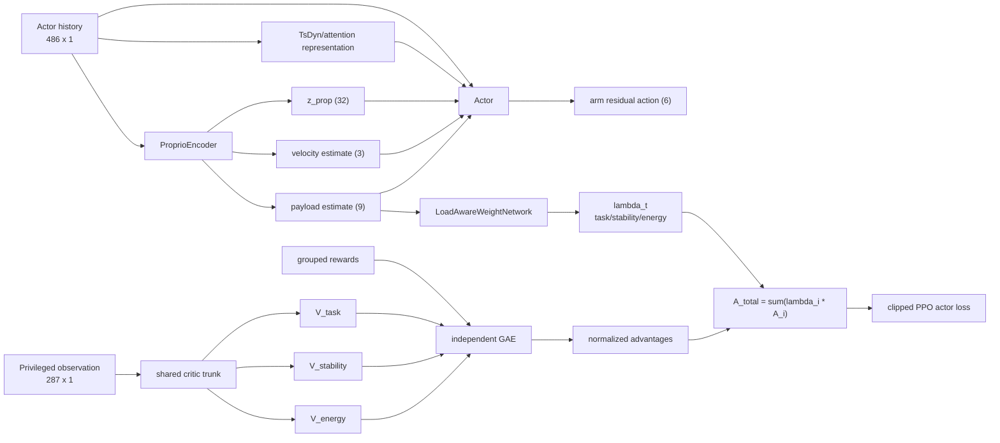

# Load-Aware Multi-Critic Advantage Fusion

> Chapter 4 now controls the 12-D Terrain-MoE Go2 actor and executes the arm
> with fixed trajectory PD control. See
> [`chapter4_trainable_base.md`](chapter4_trainable_base.md) for the final
> architecture. This document remains as the dynamic-fusion design reference.

This document describes the earlier Chapter 4 dynamic-fusion design on top of
the `go2_terrain_moe_tcn_gate_v2` quadruped base.

## Network Structure



The frozen Terrain-MoE base is outside this trainable graph. It still consumes
its independent `45 x 20 = 900` proprioceptive history and outputs 12 Go2
joint actions.

## Multi-Critic Groups

Reward names use `<group>__<function>` and retain their original scales.

- `task`: arm pose tracking, settle bonus, and PBRS progress.
- `stab`: base orientation and arm-base coupling.
- `energy`: arm power, acceleration, and action-rate costs.

All three groups must be non-empty when `value_dim=3`; startup fails instead of
silently training a dead critic.

## Payload Estimator

Input:

```text
6-frame actor observation history = 486 dimensions
```

Output:

```text
[p_com(3), gravity_torque(3), v_com(3)] = 9 dimensions
```

The target comes only from the privileged observation slice produced by
`Go2ArmEnv._compute_payload_state()`. The actor and load-weight network consume
the estimated payload. Deployment therefore does not require the simulator's
true payload label or any privileged observation.

## Dynamic Fusion Weights

The network receives the detached 9-D payload estimate:

```text
payload_hat -> Linear(9,64) -> ELU -> Linear(64,64) -> ELU -> Linear(64,3)
```

Let `s = softmax(logits)`. The simplex with minimum weight `w_min` is:

```text
lambda_i = w_min + (1 - 3*w_min) * s_i
```

With `w_min=0.05`, every weight is in `[0.05, 0.90]` and the weights sum to one.
The configured maximum must be compatible with the minimum.

The normalized per-critic advantages are fused using the weights saved during
rollout:

```text
A_total(t) = sum_i lambda_i(t) * A_hat_i(t)
```

Weights are detached before PPO uses them.

## Physical Prior Supervision

The environment already normalizes payload position, gravity torque, and COM
velocity. The risk score is:

```text
D = ap*||p_com|| + at*||tau_g|| + av*||v_com||
```

The stability target is:

```text
lambda_stab = stab_min + (stab_max-stab_min)*sigmoid(k*(D-D0))
lambda_task = q*(1-lambda_stab)
lambda_energy = (1-q)*(1-lambda_stab)
```

This is an interpretable physical prior, not a proven optimal weight target.
The gate loss is KL(prior || prediction) plus an optional adjacent-step smooth
loss. Smoothing is masked across episode boundaries.

## Gradient and Optimizer Ownership

| Optimizer | Parameters | Loss |
|---|---|---|
| PPO | actor, shared critic trunk, three critic heads, action std | clipped PPO + independent value losses |
| Payload | ProprioEncoder/payload head | payload MSE |
| Load gate | LoadAwareWeightNetwork | physical-prior KL + smoothing |
| Frozen base | Terrain-MoE base | no gradient |

PPO never backpropagates into the payload estimator or load gate. Payload and
gate losses never update the actor or critics.

## Rollout Data Flow

At rollout time, `HIMPPO.act()` saves:

- the payload prediction;
- the actual fusion weights;
- actions, value estimates, and actor distribution statistics.

For multi-critic rollouts, `HIMRolloutStorage.compute_returns()` computes three
independent GAE sequences, normalizes each advantage separately, and then
fuses them with the saved rollout-time weights. Random PPO mini-batch shuffling
therefore cannot mismatch a load state with another time step or environment.

## Experiment Modes

Set `GO2_ARM_EXPERIMENT` when launching:

| Mode | Critics | Payload estimator | Fusion |
|---|---|---|---|
| `A` | no | no | fixed |
| `B` | yes | no | fixed `[0.7,0.2,0.1]` |
| `C` | yes | yes | fixed |
| `D` | yes | yes | dynamic |
| `D1` | yes | yes | dynamic, no smoothing |
| `D2` | yes | yes | dynamic, no physical-prior KL |
| `D3` | yes | yes | full method |

Example:

```bash
GO2_ARM_EXPERIMENT=D python legged_gym/legged_gym/scripts/train.py
```

## Checkpoint Compatibility

Checkpoints now save:

- actor/critic/payload/load-gate state;
- PPO, payload, and load-gate optimizer states;
- architecture metadata including critic count and load-aware mode.

Single-critic and multi-critic checkpoints are intentionally not auto-converted.
The Terrain-MoE base checkpoint remains separately and strictly validated.

## Tests

```bash
python -m unittest discover \
  -s rsl_rl/rsl_rl/tests \
  -p 'test_load_aware_multicritic.py' -v
```

The tests cover simplex bounds, physical-prior behavior, three-head outputs,
payload/gate/PPO/value gradient isolation, optimizer ownership, independent
GAE, exact dynamic fusion, episode-boundary smoothing masks, deployment
inference, and checkpoint round trips.
